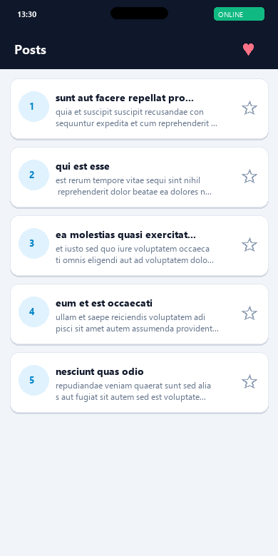
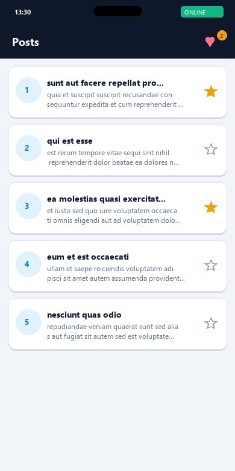
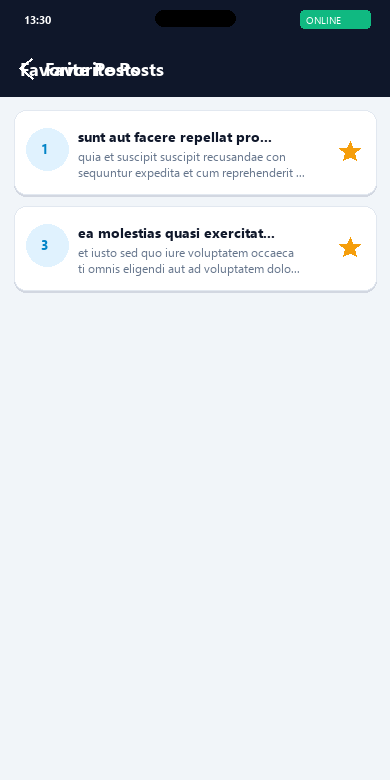
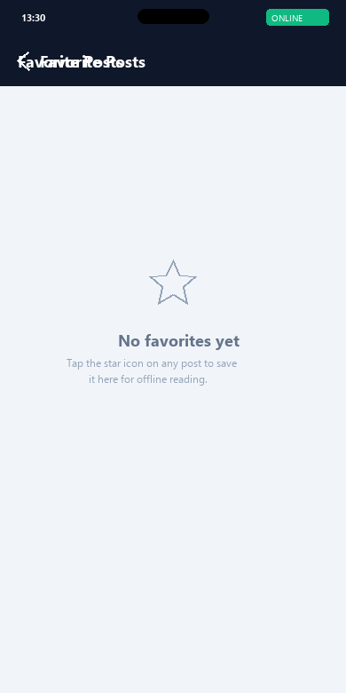
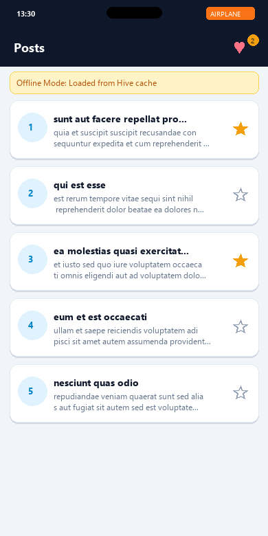

# Section 5: Offline Posts App with Hive Local NoSQL Storage & Favorites

**Student Name:** Abdallah Sameh Hassan  
**University ID:** 23010024  
**Department:** Cybersecurity  
**Course:** Mobile Computing (Fall 2026)  
**GitHub Profile:** [@body200580](https://github.com/body200580)  

---

## 📸 Feature & Action Visual Gallery

| 1. Online Posts Feed | 2. Reactive Star Favorite Toggle |
| :---: | :---: |
|  |  |
| *Fetches posts from REST API and caches to `postsBox`* | *Tapping star immediately updates icon & saves cloned copy* |

| 3. Dedicated Favorites Screen | 4. Empty Favorites State |
| :---: | :---: |
|  |  |
| *Lists all saved favorites from `favoritesBox`* | *Displays friendly "No favorites yet" empty message* |

| 5. Offline & Airplane Mode Resilience |
| :---: |
|  |
| *Zero data loss: displays cached feed and favorites even in airplane mode* |

---

## 📌 Project Overview
This project converts an online-only Flutter application into an offline-first application using **Hive NoSQL** local database storage. It fetches posts from the JSONPlaceholder REST API (`https://jsonplaceholder.typicode.com/posts`), caches them locally into `postsBox`, and allows users to mark/unmark favorite posts stored persistently in a dedicated `favoritesBox`.

### Data Flow Architecture
```text
[INTERNET] ──(HTTP GET)──> [REST API] ──(JSON)──> [Hive Cache] ──> [UI ListView]
                                                        │
                                    (Offline / Airplane)▼
                                            [Cached Posts] ──> [UI ListView]
```

---

## 📂 Project Structure
```text
lib/
├── main.dart                          # Initializes Hive, registers PostAdapter, opens boxes, runs app
├── models/
│   ├── post_model.dart                # Post entity with HiveType(typeId: 0) & HiveField annotations
│   └── post_model.g.dart              # TypeAdapter<Post> implementation for binary serialization
├── services/
│   ├── post_service.dart              # Data layer: API fetch with Hive fallback
│   └── favorites_service.dart         # Assignment: Manages favoritesBox operations (toggle, check, get)
└── screens/
    ├── posts_screen.dart              # Main feed with pull-to-refresh, reactive star toggle, & AppBar action
    └── favorites_screen.dart          # Assignment: Displays saved favorites with "No favorites yet" empty state
```

---

## 🎯 Part 3: Assignment Implementation Details

### 1. Dedicated `favoritesBox`
As specified in the lab requirements, favorites are maintained in their own box (`favoritesBox`) separate from `postsBox`. This guarantees that when `PostService.getPosts()` refreshes the main feed and clears `postsBox`, user favorites are **never lost**.

### 2. The `HiveObject` Single-Box Constraint (Crucial Warning)
> **Rule:** In Hive, a single `HiveObject` instance cannot be stored in more than one box simultaneously. Attempting to save a `Post` instance directly from `postsBox` into `favoritesBox` triggers a runtime exception.
- **Solution:** In [`FavoritesService`](lib/services/favorites_service.dart), we instantiate an independent cloned `Post` object:
  ```dart
  final copy = Post(
    id: post.id,
    title: post.title,
    body: post.body,
    userId: post.userId,
  );
  await _box.put(post.id, copy);
  ```

### 3. Immediate UI Reactivity with `ValueListenableBuilder`
Instead of calling manual `setState()` or complex state listeners, the application uses `Hive.box<Post>('favoritesBox').listenable()`:
- When a user taps a star icon on [`PostsScreen`](lib/screens/posts_screen.dart), the star switches instantly between `Icons.star` (filled amber) and `Icons.star_border`.
- When an item is unfavorited from [`FavoritesScreen`](lib/screens/favorites_screen.dart), the list updates immediately in real-time, and returning to the feed reflects the updated state seamlessly.

### 4. Empty State UX
When no posts have been favorited yet, [`FavoritesScreen`](lib/screens/favorites_screen.dart) displays an informative message:
> **"No favorites yet"**  
> *"Tap the star icon on any post to save it here for offline reading."*

---

## 🧪 How to Test Offline Mode
1. **Online Load**: Launch the app with internet enabled. All 100 posts load from the REST API and are cached to `postsBox`.
2. **Favorite Posts**: Tap the star icon on posts (e.g. Posts #1, #3, #7).
3. **Verify Favorites Screen**: Tap the favorite icon in the top AppBar to confirm they are displayed.
4. **Enable Airplane Mode**: Disconnect Wi-Fi and mobile data.
5. **App Restart**: Terminate the app completely and reopen it.
   - The main feed continues to display cached posts (`postsBox`).
   - The favorites screen continues to display all saved favorites (`favoritesBox`).

---

## 🚀 Running the Project Locally
```bash
# 1. Install dependencies
flutter pub get

# 2. Run the application
flutter run -d chrome
# or
flutter run -d windows
```
